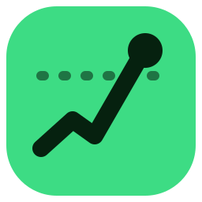

# Pass Odds



**Which MyFundedPerps challenge should you buy?**

Tell Pass Odds how you trade: win rate, average win and loss, risk per trade, trades a day. It simulates every plan and account size under the real rules and recommends the account that gives your strategy the best chance to pass. It also sizes trades so the order fits the market's limits and today's loss room.

Free. No login. No API key. Everything runs in your browser.

> **Simulated results, not real ones.** Traders pass or blow accounts mostly on self-control: sticking to their stop, their risk and their own rules. Pass Odds only helps you choose an account that suits your strategy. Unofficial community tool, not made by or affiliated with MyFundedPerps. Not financial advice.

## What it does

**Find my account**
- Recommends the best plan (Select, Signature, Elite with or without a daily loss limit) for your strategy, and the best size too when you risk a fixed dollar amount per trade.
- Ranks every account for you, with pass chance, breach chance and typical days to pass. Click any row to inspect it.
- For the shown account: chance to pass, fail on the daily loss limit, fail on max drawdown, 50 sample equity paths, and "what would change your odds" (half the risk, your own daily stop, more winners, lower costs).
- The challenge has no time limit, so by default odds are counted with no deadline; you can set your own.
- Shareable 1200×675 image and a link that reopens the page with the same stats.

**Position sizer**
- Pick any of the firm's markets. The size is rounded down to the market's size step and checked against its minimum order and max leverage (from the firm's public market list).
- Live price and a 1.5 × ATR stop from free public feeds (Binance, Hyperliquid).
- Caps the risk at what's left before today's daily loss limit and above the drawdown floor.
- Never places orders.

## Rules model

From the MyFundedPerps [challenge guide](https://docs.myfundedperpetuals.com/guides/challenges-and-rules), read 2026-11-24:

| Plan | Profit target | Daily loss | Max drawdown |
|---|---|---|---|
| Select | 9% | 3% | 3% |
| Signature | 10% | 3% | 6% |
| Elite (3% DLL) | 10% | 3% | 5% |
| Elite (no DLL) | 10% | none | 5% |

- All limits are a share of the **starting** balance. Max drawdown is static (it doesn't trail).
- Daily loss counts from the balance at the start of each day (midnight New York time) and includes open P&L.
- Reaching a limit is treated as a breach.

Trade model: each trade wins your average win or loses your average loss (in R), minus a fixed cost. A losing trade is assumed to go straight to its stop. Real trades vary more than averages, so treat the result as a guide, not a forecast.

## Data sources

| Data | Source | Key needed |
|---|---|---|
| Market list (leverage, min order, size step) | `GET https://developers.myfundedperpetuals.com/v1/markets` | No |
| Crypto prices and candles | Binance public API | No |
| Stocks, commodities, indices | Hyperliquid public info API | No |

The firm's API only allows browser calls from its docs site, so a GitHub Action (`.github/workflows/update-markets.yml`) refreshes `data/markets.json` every hour.

## Run it locally

```bash
python3 -m http.server 8080
```

Then open http://localhost:8080. (Opening `index.html` directly won't load the market list.)

## Tests

```bash
npm test
```

The engine (`js/sim.js`) and sizer (`js/sizer.js`) are plain modules with no DOM, tested with Node's built-in test runner.

## Roadmap

- **v0.1** Pass odds, plan picker, position sizer, share card.
- **v0.1.1** Recommends the account (plan and size) from your strategy, fixed-$ risk mode, logo.
- **v0.2** "Why did I fail?": read-only API key → replay your real fills against the limit lines and mark the trade that broke the account.
- **v0.3** Live odds from the account stream, plus an OBS overlay for streamers.
- Claude skill and MCP wrapper so traders can ask their own Claude for odds and sizes.

## License

MIT

## Security

- Static site, no backend, no accounts, no keys. Nothing you type leaves your browser except price requests to Binance and Hyperliquid.
- Strict Content Security Policy: scripts only from this site; network calls only to this site, Binance and Hyperliquid.
- Every value inserted into the page is HTML-escaped. Market data from the firm's API is validated (plain symbols, positive numbers) before it is committed.
- Share-link values are clamped to the form's limits, so a crafted link can't freeze the page.
- GitHub Actions are pinned to commit SHAs, and the workflow token is read-only except for the one job that commits the market list.

Found a problem? Open an issue.
